<div align="center">

<!-- ================= HEADER ================= -->


<!-- ================= TYPING ANIMATION ================= -->
<a href="https://github.com/AdiTheDataAnalyst">
  
</a>

<br/>


<br/><br/>


<br/><br/>

<!-- ================= SOCIAL ================= -->
<p align="center">
  <a href="YOUR_LINKEDIN_URL"></a>
  <a href="https://github.com/AdiTheDataAnalyst"></a>
  <a href="mailto:YOUR_EMAIL"></a>
  <a href="YOUR_RESUME_URL"></a>
</p>

### 📊 *Turning data into insights, and insights into better business decisions.*

</div>


## 👋 About Me

<table>
<tr>
<td width="62%" valign="top">

```python
class AdityaChoudhari:
    def __init__(self):
        self.alias      = "Adi"
        self.location   = "Nagpur, India 🇮🇳"
        self.role       = "Aspiring Data Analyst"
        self.education  = [
            "MBA — Marketing & Finance",
            "M.Sc. — Data Science & Analytics with AI",
        ]
        self.stack      = ["Python", "SQL", "Power BI", "Tableau", "Excel"]
        self.superpower = "Business thinking + technical analytics"

    def mission(self):
        return "Turn messy data into clean, decision-ready stories"
```

</td>
<td width="38%" valign="top">

- 🎓 **MBA in Marketing & Finance**, now pivoting into **Data Analytics & BI**
- 🤖 Pursuing a **Master's in Data Science & Analytics with AI**
- 🐍 Building **Streamlit apps** and **ML projects** end-to-end
- 📈 Love **clean visual stories** that drive decisions
- 🌱 Bridging **business strategy** and **technical analytics**

</td>
</tr>
</table>

## 🚀 Currently Working On

<div align="center">


</div>


## 🧰 Tech Stack

<div align="center">

### 🐍 Programming & Data

<br/>


### 📊 BI & Visualization


### 🖥️ Apps & Scraping


</div>


## 💼 Featured Projects

<table width="100%">
<tr>
<td width="50%" valign="top">

### 🤖 Loan Risk Intelligence Platform
End-to-end **machine learning project** that predicts loan default risk, with a polished interactive front end.

**Tech:** `Python` `Scikit-learn` `Pandas` `Streamlit` `Plotly`

**Highlights**
- Trained on the Kaggle loan default dataset
- Compares **three ML algorithms** side by side
- Interactive risk prediction dashboard

🔗 [Repository](PROJECT_REPOSITORY_URL) &nbsp;|&nbsp; 🌐 [Live Demo](LIVE_DEMO_URL)

</td>
<td width="50%" valign="top">

### 🛒 Bharat Store — Inventory & Sales Suite
Multi-page **POS + inventory + sales system** with a glassmorphism, India tri-colour themed UI.

**Tech:** `Python` `Streamlit` `OOP` `Pandas` `Plotly` `CSS`

**Highlights**
- Full CRUD for products & customers
- POS terminal with cart & discount coupons
- Plotly analytics, low-stock alerts, receipts
- Modular OOP architecture

🔗 [Repository](https://github.com/AdiTheDataAnalyst/inventory_management_system) &nbsp;|&nbsp; 🌐 [Live Demo](LIVE_DEMO_URL)

</td>
</tr>
<tr>
<td width="50%" valign="top">

### 🏦 Banking Fraud Detection System
**Rule-based fraud detection** with risk scoring and an analyst workflow.

**Tech:** `Python` `Streamlit` `Plotly` `JSON`

**Highlights**
- Risk scoring engine & analyst action center
- Geographic map visualization
- JSON audit logging

🔗 [Repository](PROJECT_REPOSITORY_URL) &nbsp;|&nbsp; 🌐 [Live Demo](LIVE_DEMO_URL)

</td>
<td width="50%" valign="top">

### 🏥 Hospital Patient Record Analytics
**Analytics app** for hospital data with upload, validation and reporting.

**Tech:** `Python` `Streamlit` `Pandas` `Plotly`

**Highlights**
- CSV upload with schema validation
- Disease, doctor & admission analytics
- Exportable reports

🔗 [Repository](PROJECT_REPOSITORY_URL) &nbsp;|&nbsp; 🌐 [Live Demo](LIVE_DEMO_URL)

</td>
</tr>
<tr>
<td width="50%" valign="top">

### 📊 Swiggy Sales Dashboard
Interactive **Power BI dashboard** for sales performance with DAX-driven KPIs.

**Tech:** `Power BI` `DAX` `Power Query`

**Highlights**
- KPI tracking & drill-downs
- DAX measures for business logic
- Power Query data transformation

🔗 [Repository](PROJECT_REPOSITORY_URL)

</td>
<td width="50%" valign="top">

### 🗄️ SQL Business Analysis
**MySQL analyses** answering real business questions, including a Hotel Management System.

**Tech:** `MySQL` `SQL`

**Highlights**
- Joins, subqueries & aggregations
- Business-focused reporting
- Query optimization

🔗 [Repository](PROJECT_REPOSITORY_URL)

</td>
</tr>
<tr>
<td colspan="2" valign="top">

### 📚 Book Scraping & Analysis
**Web scraping + analysis pipeline** that collects, cleans and visualizes book data in an interactive dashboard.

**Tech:** `Python` `BeautifulSoup` `Requests` `Pandas` `Streamlit` &nbsp;|&nbsp; 🔗 [Repository](PROJECT_REPOSITORY_URL) &nbsp;|&nbsp; 🌐 [Live Demo](LIVE_DEMO_URL)

</td>
</tr>
</table>


## 🎯 What I Build

<div align="center">

| 📊 Business Analytics | 🐍 Python Automation | 🗄️ SQL Data Analysis |
|:---:|:---:|:---:|
| **📈 Power BI Dashboards** | **🛒 Business Applications** | **🌐 Web Scraping** |
| **🤖 ML Prediction Apps** | **📉 Data Visualization** | **🛡️ Risk & Fraud Analytics** |

</div>


## 📈 GitHub Statistics

<div align="center">


<br/>


</div>

## 🌱 Contribution Activity

<div align="center">


</div>

## 🏆 GitHub Trophies

<div align="center">


</div>

<!-- ================= CONTRIBUTION SNAKE ================= -->
<div align="center">

### 🐍 Contribution Snake

<picture>
  <source media="(prefers-color-scheme: dark)" srcset="https://raw.githubusercontent.com/AdiTheDataAnalyst/AdiTheDataAnalyst/output/github-contribution-grid-snake-dark.svg" />
  <source media="(prefers-color-scheme: light)" srcset="https://raw.githubusercontent.com/AdiTheDataAnalyst/AdiTheDataAnalyst/output/github-contribution-grid-snake.svg" />
  
</picture>

</div>


## 🛤️ Learning Journey

```mermaid
flowchart LR
    A([🎓 MBA<br/>Marketing & Finance]) --> B([🐍 Python])
    B --> C([🗄️ SQL / MySQL])
    C --> D([📗 Advanced Excel])
    D --> E([📊 Power BI & DAX])
    E --> F([🖥️ Streamlit Apps])
    F --> G([🤖 Machine Learning])
    G --> H([🚀 Data Analyst])

    style A fill:#0f2027,stroke:#00c6ff,color:#fff
    style B fill:#0f2027,stroke:#00c6ff,color:#fff
    style C fill:#0f2027,stroke:#00c6ff,color:#fff
    style D fill:#0f2027,stroke:#00c6ff,color:#fff
    style E fill:#0f2027,stroke:#00c6ff,color:#fff
    style F fill:#0f2027,stroke:#00c6ff,color:#fff
    style G fill:#0f2027,stroke:#00c6ff,color:#fff
    style H fill:#00c6ff,stroke:#fff,color:#000
```

<div align="center">



</div>

## 🎯 Current Goal

> **Building a strong career in Data Analytics & Business Intelligence by combining business knowledge with technical and analytical skills.**

## 💡 Fun Fact

<div align="center">


</div>


## 📬 Let's Connect

<div align="center">

<a href="YOUR_LINKEDIN_URL"></a>
<a href="mailto:YOUR_EMAIL"></a>

<br/><br/>

### 💬 *"Turning data into insights, and insights into better business decisions."*

<br/>


</div>
